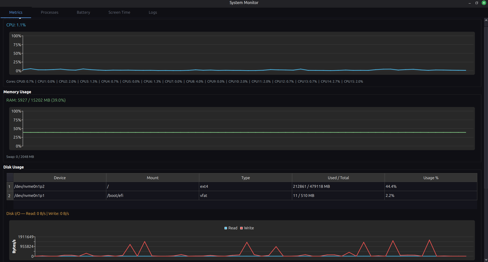
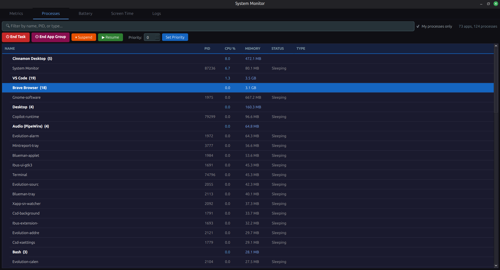
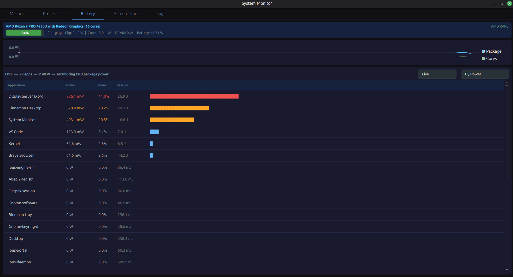
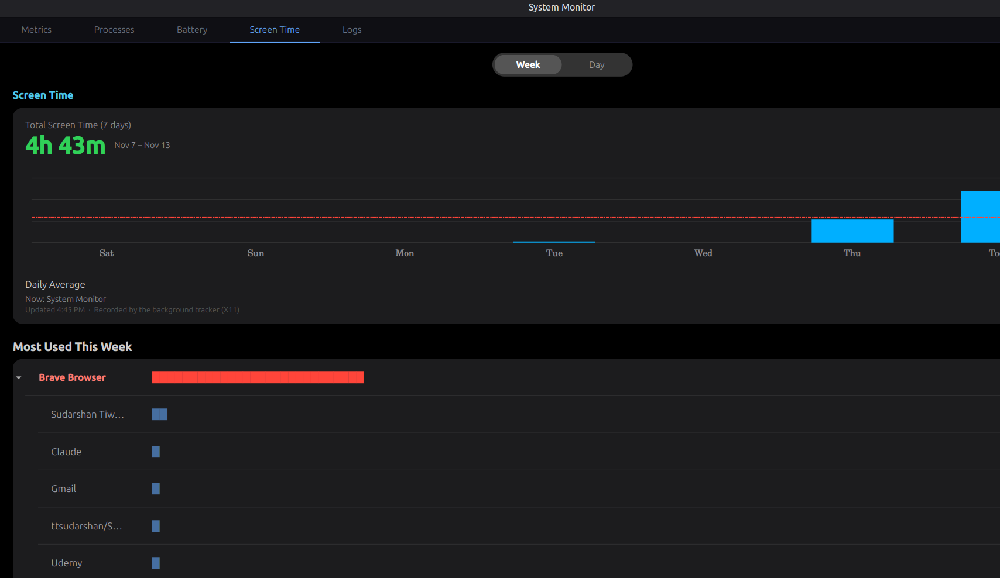
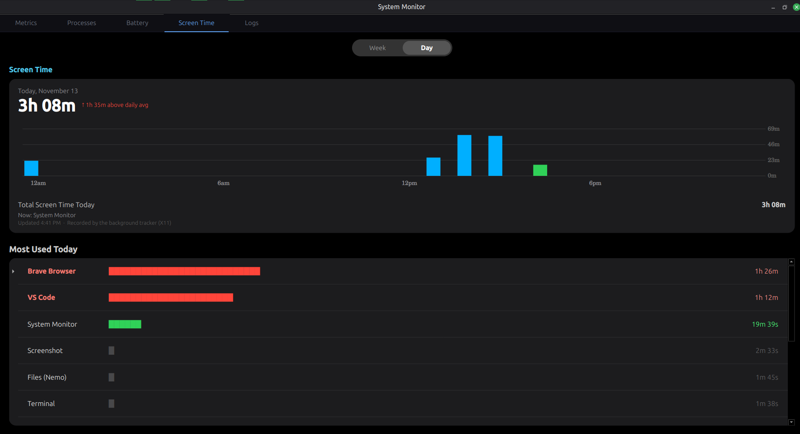

# System Monitor

A real-time Linux system monitoring application built with C++17, Qt6, and CMake. Tracks CPU, memory, disk, network, processes, per-app energy use, and screen time — similar to Windows Task Manager and iOS Screen Time combined.

## Features

- **Metrics** — Live graphs for CPU (per-core), memory, swap, disk I/O, and network bandwidth with color-coded warnings
- **Processes** — App-grouped process view (like Windows Task Manager), kill/suspend/resume/renice. Browser helper processes are labelled (Tab, GPU Process, Extension, …)
- **Battery** — Package/core/DRAM power from Intel or AMD RAPL, per-app power attribution by CPU-time share, daily/weekly energy history
- **Screen Time** — iOS-style screen time: **Week** view shows 7 daily bars and the daily average, **Day** view shows today hour by hour. Per-app breakdown, with per-site breakdown nested under browsers (Brave, Firefox, Chrome, Edge, …)
- **Logs** — Configurable alerts (CPU > 90%, memory, disk), timestamped event log, CSV export of the last 24 h of samples

All sampling (`/proc`, `/sys`, X11, SQLite) runs on a worker thread, so the window stays responsive.

## Screenshots

**Metrics** — live CPU, memory, disk and network graphs



**Processes** — processes grouped by application, with end/suspend/resume/renice



**Battery** — RAPL package/core power and per-app power attribution



**Screen Time** — Week view with daily average and per-app / per-site breakdown



**Screen Time** — Day view, today hour by hour



## How Screen Time Works

Screen time is collected by a **standalone background daemon** (`sysmon-tracker`) that runs as a systemd user service, completely independent of the GUI. Closing the GUI window does not stop tracking. If the daemon is not running, the GUI records time itself while it is open, and says so on the Screen Time tab.

- Every second the daemon records the focused application, via X11 `_NET_ACTIVE_WINDOW` → `WM_CLASS`
- For browsers it reads the window title (`_NET_WM_NAME`) and extracts the site name ("YouTube", "GitHub", …) to give a per-site breakdown nested under the browser
- Time is stored per **hour**, which is what the Day view's hourly chart is built from
- Counting pauses when the screen is off (DPMS), the X screensaver is active, or the desktop's screensaver/lock reports active over DBus (Cinnamon, GNOME, MATE, XFCE, KDE)
- If the daemon starts before the X server is ready (typical at login), it keeps retrying and picks `DISPLAY`/`XAUTHORITY` up from the systemd user environment; nothing is recorded until it can see the display
- Writes to SQLite at `~/.local/share/SystemMonitor/sysmon.db`; the GUI reads from the same file. Energy history lives in the same database

## Distro & Desktop Compatibility

The build itself runs on any modern Linux (Ubuntu, Mint, Fedora, RHEL/CentOS Stream 9+, Arch). All the system-stat metrics — CPU, memory, disk, network, battery, RAPL — read from `/proc` and `/sys` and behave the same everywhere.

**Screen time tracking is where your display server matters.** The daemon uses three detection paths in this priority order:

| Session | Detection path | Accuracy |
|---|---|---|
| **Any Xorg / X11 session** (incl. "GNOME on Xorg", XFCE, Cinnamon, MATE, KDE/X11) | `_NET_ACTIVE_WINDOW` + `WM_CLASS` via Xlib | **Full** — focused app + browser site name |
| GNOME on Wayland *with a companion Shell extension that exposes `org.sysmon.Tracker.GetActiveApp` on the session bus* | DBus call | Full app name (no site names). The extension is **not included** in this repository |
| KDE/Sway/Hyprland/etc. on Wayland, **or** GNOME Wayland without the extension | `/proc/*/maps` CPU-delta heuristic | **Approximate** — picks the busiest GUI process, misses idle-but-focused apps, no site names |

The heuristic is only used in Wayland sessions. On an X11 session where the display is temporarily unavailable, the daemon records nothing rather than guessing.

**Recommendation:** if you're on Fedora Workstation, Fedora KDE Spin, or CentOS Stream and want the most accurate screen time data, log into an **Xorg session** at the login screen ("GNOME on Xorg" / "Plasma (X11)").

## Prerequisites

- Linux (tested on Linux Mint 22 / Ubuntu 24.04; should build on Fedora 39+ and RHEL/CentOS Stream 9+)
- C++17 compiler (GCC 9+ or Clang 10+)
- CMake 3.16+
- Qt6 with Widgets and Charts modules
- X11, XScreenSaver and Xext (DPMS) development libraries
- SQLite3 development library

## Install

### 1. Install dependencies

**Debian / Ubuntu / Mint:**

```bash
sudo apt update
sudo apt install cmake g++ \
    qt6-base-dev libqt6charts6-dev \
    libx11-dev libxss-dev libxext-dev libsqlite3-dev
```

**Fedora:**

```bash
sudo dnf install cmake gcc-c++ \
    qt6-qtbase-devel qt6-qtcharts-devel \
    libX11-devel libXScrnSaver-devel libXext-devel sqlite-devel
```

**RHEL / CentOS Stream 9+** (enable CRB/EPEL first if Qt6 isn't found):

```bash
sudo dnf install epel-release
sudo dnf config-manager --set-enabled crb
sudo dnf install cmake gcc-c++ \
    qt6-qtbase-devel qt6-qtcharts-devel \
    libX11-devel libXScrnSaver-devel libXext-devel sqlite-devel
```

### 2. Clone and build

Both the GUI and the daemon are built together with a single CMake command:

```bash
git clone https://github.com/ttsudarshan/system-monitor.git
cd system-monitor
cmake -B build -DCMAKE_BUILD_TYPE=Release
cmake --build build -j$(nproc)
```

### 3. Install the GUI

Either system-wide:

```bash
sudo cp build/SystemMonitor /usr/local/bin/SystemMonitor
```

or just for your user (this also installs the daemon binary):

```bash
cmake --install build --prefix ~/.local     # ~/.local/bin/SystemMonitor
```

Add a desktop shortcut so it appears in your app menu:

```bash
mkdir -p ~/.local/share/applications
cat > ~/.local/share/applications/system-monitor.desktop << 'EOF'
[Desktop Entry]
Name=System Monitor
Exec=/usr/local/bin/SystemMonitor
Type=Application
Categories=System;Monitor;
Comment=System monitor with battery and screen time tracking
EOF
```

### 4. Install the screen time daemon

The daemon must be installed and running for screen time to accumulate when the GUI is closed.

**Option A — automated (recommended):**

```bash
chmod +x install-tracker.sh
./install-tracker.sh
```

**Option B — manual:**

```bash
cmake --install build --prefix ~/.local   # puts it at ~/.local/bin/sysmon-tracker

mkdir -p ~/.config/systemd/user
cp sysmon-tracker.service ~/.config/systemd/user/
systemctl --user daemon-reload
systemctl --user enable sysmon-tracker
systemctl --user restart sysmon-tracker    # restart, so an older running daemon is replaced
```

### 5. Set up battery monitoring permissions (optional)

Required for hardware-accurate power readings via Intel/AMD RAPL:

```bash
echo 'SUBSYSTEM=="powercap", ACTION=="add", RUN+="/bin/chmod o+r %S%p/energy_uj"' | \
    sudo tee /etc/udev/rules.d/99-rapl.rules
sudo udevadm control --reload-rules && sudo udevadm trigger
```

Without this, per-app power is attributed from the battery's own discharge reading while on battery; on AC power only the CPU share is shown.

## Verify Everything Works

```bash
# Launch the GUI
SystemMonitor

# Check the screen time daemon is running and sees the display
systemctl --user status sysmon-tracker
journalctl --user -u sysmon-tracker -n 5        # should say "Connected to X display" / "Tracking via X11"

# Confirm it starts automatically on login
systemctl --user is-enabled sysmon-tracker

# Check RAPL permissions (optional)
cat /sys/class/powercap/intel-rapl:0/energy_uj
```

## Upgrading from an older version

- The database schema is migrated automatically on first start (an `hour` column is added; older rows keep `hour = -1` and only appear in daily totals, not in the hourly Day chart)
- Older versions kept battery history in a second database under `~/.local/share/System Monitor/` (with a space). The GUI merges it into `sysmon.db` on first start and renames the old file to `sysmon.db.imported`
- Rows recorded by the old CPU heuristic for tray applets and session daemons are removed once

## Uninstall

```bash
# Remove the GUI
sudo rm /usr/local/bin/SystemMonitor
rm -f ~/.local/bin/SystemMonitor ~/.local/share/applications/system-monitor.desktop

# Remove the screen time daemon
systemctl --user disable --now sysmon-tracker
rm ~/.local/bin/sysmon-tracker
rm ~/.config/systemd/user/sysmon-tracker.service
systemctl --user daemon-reload

# Remove the RAPL udev rule (if installed)
sudo rm /etc/udev/rules.d/99-rapl.rules

# Remove all tracked data
rm -rf ~/.local/share/SystemMonitor "~/.local/share/System Monitor"
```

## Project Structure

```
system-monitor/
├── CMakeLists.txt                  # Builds sysmon-core, the GUI and the daemon
├── Readme.md
├── screenshots/
├── install-tracker.sh              # One-step daemon install helper
├── sysmon-tracker.service          # systemd user service unit
└── src/
    ├── core/                       # Shared by GUI and daemon, no Qt dependency
    │   ├── AppNames.h/cpp          # Process/WM_CLASS -> app name normalisation (single source of truth)
    │   ├── SysmonDb.h/cpp          # SQLite schema, migrations, queries
    │   ├── FocusDetector.h/cpp     # Focused app, browser site name, screen off / lock detection
    │   └── ProcScan.h/cpp          # One /proc pass: per-process CPU/memory + per-app CPU share
    ├── daemon/
    │   └── sysmon-tracker.cpp      # Daemon entry point + main loop
    ├── main.cpp
    ├── MainWindow.h/cpp            # Tabs, refresh timer, worker thread wiring
    ├── SampleWorker.h/cpp          # Worker thread: runs all monitors, emits a Snapshot
    ├── Snapshot.h                  # Plain data handed from the worker to the UI
    ├── monitors/
    │   ├── CpuMonitor.h/cpp        # /proc/stat parsing
    │   ├── MemoryMonitor.h/cpp     # /proc/meminfo parsing
    │   ├── DiskMonitor.h/cpp       # /proc/diskstats + statvfs
    │   ├── NetworkMonitor.h/cpp    # /proc/net/dev parsing
    │   ├── BatteryMonitor.h/cpp    # /sys/class/power_supply
    │   ├── EnergyMonitor.h/cpp     # RAPL / amd_energy + per-app attribution + energy history
    │   └── ScreenTimeTracker.h/cpp # GUI-side stats + fallback recording when the daemon is absent
    └── widgets/
        ├── MetricsTab.h/cpp        # CPU, memory, disk, network charts
        ├── ProcessesTab.h/cpp      # Process list with app grouping
        ├── BatteryStatsTab.h/cpp   # Battery and energy UI
        ├── ScreenTimeTab.h/cpp     # Screen time UI (week/day charts, nested browser sites)
        └── LogsTab.h/cpp           # Alerts and log export
```

## How It Works

| Data | Source | Method |
|------|--------|--------|
| CPU usage | `/proc/stat` | Delta between reads |
| Memory | `/proc/meminfo` | MemTotal − MemAvailable |
| Disk I/O | `/proc/diskstats` | Sector read/write deltas |
| Disk usage | `/proc/mounts` + `statvfs()` | Filesystem stats |
| Network | `/proc/net/dev` | RX/TX byte deltas |
| Processes | `/proc/[pid]/stat`, `statm`, `cmdline` | One scan per refresh, shared with energy attribution |
| Battery | `/sys/class/power_supply/<battery>/` | capacity, power_now, status, energy_now |
| CPU power | `/sys/class/powercap/intel-rapl:0/` | RAPL energy counters (µJ) |
| Per-app energy | package power × app's share of CPU ticks | Accumulated to Wh per app per day |
| Screen time | X11 `_NET_ACTIVE_WINDOW` + `WM_CLASS` | Focused window per second, stored per hour |
| Browser sites | X11 `_NET_WM_NAME` (window title) | Known-site match, then "Page · Site" split |
| Screen off / lock | DPMS, `XScreenSaverQueryInfo`, desktop ScreenSaver DBus | Pause tracking |
